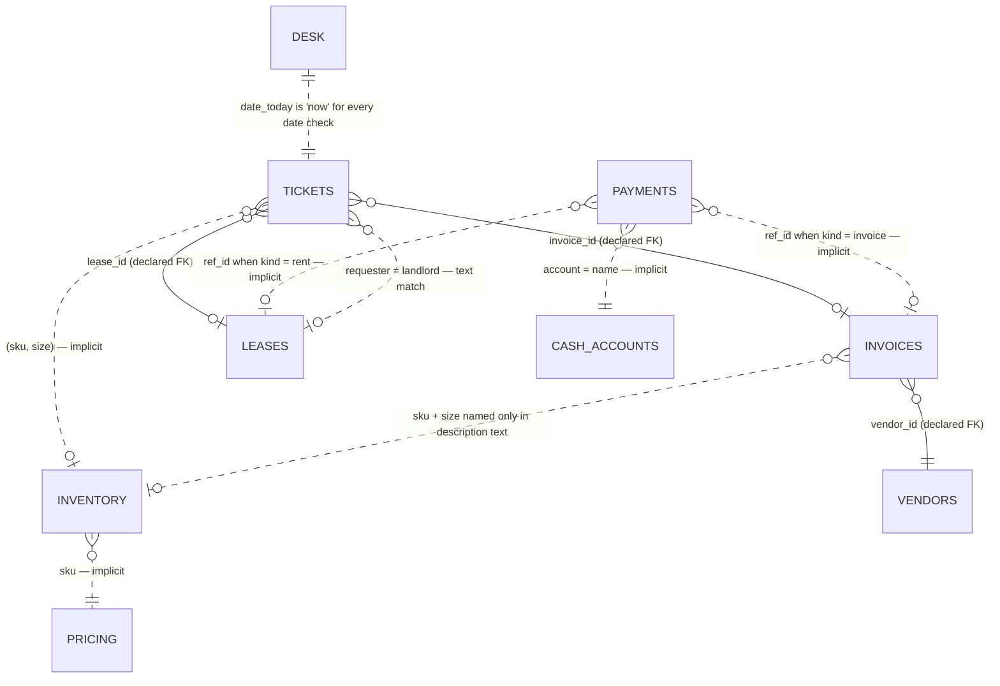

# Campus Customs — How the Tables Link

Source: `data/campus_customs_new.db` (a copy of the original `data/campus_customs.db`). Business date: **2026-08-31**, from `desk.date_today`.

## Relationship map



Solid lines are foreign keys declared in the schema. Dotted lines are links the data relies on that the schema does not declare.

## 1. Declared foreign keys (only 3)

| From | To | Notes |
|---|---|---|
| `invoices.vendor_id` | `vendors.id` | Invoice 501 → Bulldog Print Co (apparel reprint, 5-day lead time) |
| `tickets.invoice_id` | `invoices.id` | Ticket 101 → Invoice 501 |
| `tickets.lease_id` | `leases.id` | Ticket 102 → Lease 1 |

**SQLite has foreign-key enforcement switched off** (`PRAGMA foreign_keys = 0`). Unless each connection runs `PRAGMA foreign_keys = ON`, these constraints are only documentation. `PRAGMA foreign_key_check` currently reports no orphaned rows.

## 2. Implicit links (no constraint, the app must enforce them)

| Link | How it joins | Why it's fragile |
|---|---|---|
| Product price | `inventory.sku = pricing.sku` | One `pricing` row per SKU; `inventory` has one row per **SKU + size**. All 4 SKUs match today. |
| Ticket → stock | `tickets.sku, tickets.size` → `inventory (sku, size)` (its composite primary key) | Nothing stops a ticket from naming a SKU or size that doesn't exist. |
| Payment → what was paid | `payments.ref_id` → `invoices.id` **or** `leases.id`, depending on `payments.kind` | `ref_id` points to different tables depending on `kind`, so a foreign key can't cover it. The app must check `kind` before resolving it. |
| Payment → source of funds | `payments.account = cash_accounts.name` | A plain text match. `checking` is the only account. |
| Invoice → product | Only through `invoices.description` ("Rush reprint CC-TEE-WHITE S") | Free text. No `sku` or `size` column. |
| Ticket → counterparty | `tickets.requester = leases.landlord` ("Elm City Properties") | Text match. Customers (Tauhid Zaman, Yale AI Club) have no table of their own. |
| Everything → "today" | `desk.date_today` | The single clock for overdue checks and days-until-due. `cash_accounts.date` is when the balance was last updated. |

## 3. Each open ticket followed through the tables

### Ticket 101 — customer order (Tauhid Zaman, 1× Classic Bulldog Tee, size S)
```
tickets 101 ──sku,size──▶ inventory (CC-TEE-WHITE, S): qty 0, Aisle B   ✗ out of stock
            ──invoice_id─▶ invoices 501: $840, due 2026-08-28, open     ✗ 3 days overdue
                              └─vendor_id─▶ vendors 1 Bulldog Print Co, lead 5 days
inventory ──sku──▶ pricing CC-TEE-WHITE: cost $8, list $28
```
The order can't ship until the reprint arrives, and the reprint is tied to an overdue bill. Even if the bill is paid today, the vendor's 5-day lead time means about 2026-09-05 at the earliest.

### Ticket 102 — rent notice (Elm City Properties)
```
tickets 102 ──lease_id──▶ leases 1 Chapel Street shop: $2,400, next_due 2026-09-02 (2 days away)
            ──requester = landlord (text)
payment would go to: payments(kind=rent, ref_id=1, account=checking, approved_by=?)
```
After rent is paid, `leases.next_due` has to move forward a month and `cash_accounts.balance` has to go down.

### Ticket 103 — price override (Yale AI Club, 20× Basic Hoodie Big Yale, size M)
```
tickets 103 ──sku,size──▶ inventory (CC-HOOD-NAVY, M): qty 8 of the 20 requested   ✗ short 12
            ──sku──▶ pricing CC-HOOD-NAVY: cost $22, list $58 (margin $36 / 62%)
other hoodie sizes on hand: S 4, L 14, XL 6 (32 total across sizes)
```
At list price, 20 hoodies come to $1,160. The cost floor is $440, so any discount has to stay above $22 per hoodie. Restocking would go through Bulldog Print Co (apparel reprint, 5 days).

## 4. Cross-table pressure: cash

| Item | Amount | Due |
|---|---|---|
| Checking balance | **$3,400** | as of 2026-08-31 |
| Invoice 501 (Bulldog Print Co) | −$840 | 2026-08-28 (overdue) |
| Lease 1 rent | −$2,400 | 2026-09-02 |
| **Left if both are paid** | **$160** | |

The tickets aren't independent. Paying the invoice unblocks ticket 101. Paying rent closes ticket 102. Both draw on the same $3,400. If ticket 103 needs a restock order, that adds a new cost on top. This is why payments carry an `approved_by` field and should wait for a human to sign off.

## 5. Gaps the agents will run into

- `payments` is empty. There is no payment history and no record of how a payment changes `invoices.status` or the cash balance, so the app has to define that.
- No `orders` or `customers` table. A customer order exists only as a ticket.
- The Crest Mug (`CC-MUG-CREST`, size OS) is at 0 stock with no ticket or open reorder. Elm City Gifts supplies mugs.
- No column records when stock is due back, so a reprint's arrival date can only be estimated from `vendors.lead_days`.
- Statuses are all `open`. No other status values appear yet, so the agents' workflow will have to define them (e.g. `pending_approval`, `paid`, `closed`).
